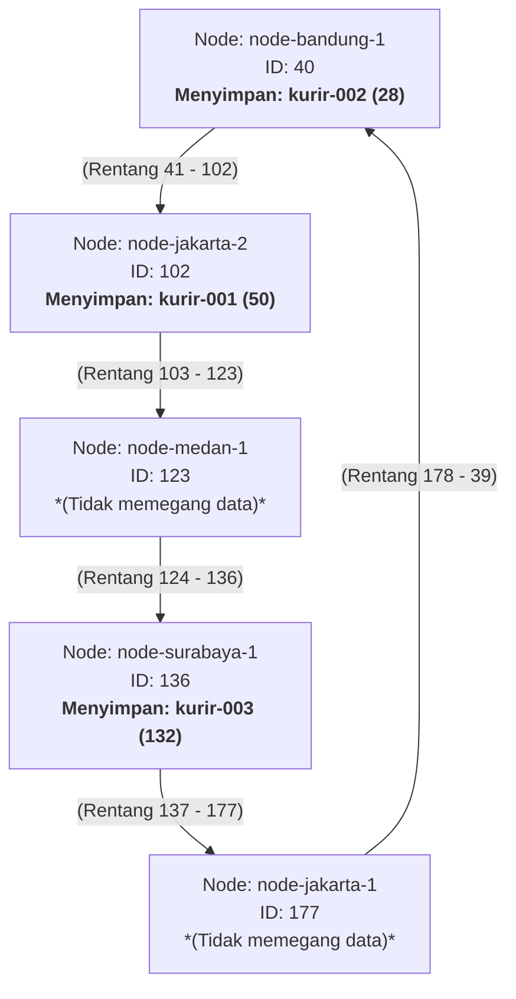

# Jurnal Proses — Tugas 6

## Implementasi find_successor

- Kesalahan pertama yang ditemui (mis. lupa wrap-around di ring): typo dan kesalahan logika
- Cara memperbaikinya: analisis kembali kode untuk menemukan letak kesalahan, lalu perbaiki.

## Skenario join/leave

- Hasil sebelum & sesudah node baru bergabung: Sebelumnya terdapat 4 node (node jakarta-1, jakarta-2, bandung-1, surabaya-1) dan kurir-001 dipegang node jakarta-2, kurir-002 dipegang node bandung-1, dan kurir-003 dipegang node surabaya-1. Setelah node baru (node-medan-1) bergabung, kurir tetap dipegang node yang sama, yang artinya tidak ada perubahan.
- Hasil sebelum & sesudah node keluar: Sebelumnya kurir memiliki successor seperti poin pertama. Setelah node jakarta-1 keluar, tidak ada perubahan pada successor kurir dikarenakan node jakarta-1 tidak menjadi successor pada kurir manapun.

## Tugas Analisis

1. Jelaskan **kenapa DHT/Chord** lebih cocok untuk kasus ini dibanding **flat naming sederhana** (mis. tabel pusat ID→IP) atau **DNS konvensional** — kaitkan dengan sifat "IP kurir sering berubah" dan kebutuhan tanpa titik gagal tunggal.
   Jawaban: DHT/Chord lebih cocok untuk kasus ini dibanding **flat naming sederhana** (tabel pusat ID→IP) atau **DNS konvensional** karena sistem pelacakan kurir membutuhkan pembaruan alamat IP yang cepat. Jika menggunakan tabel pusat, sistem berisiko mengalami gangguan ketika server utamanya bermasalah dan server juga bisa melambat ketika banyak kurir memperbarui data secara bersamaan. Selain itu, DNS memiliki waktu TTL yang membuat perubahan informasi tidak selalu langsung diperbarui. Sehingga dipilih DHT/Chord karena akan membagi penyimpanan dan pencarian ke banyak node tanpa harus bergantung pada satu server pusat. Sehingga, proses pembaruan data kurir dapat berjalan lebih cepat, stabil, dan tetap berfungsi jika ada node lain yang mengalami gangguan.
2. Gambarkan (boleh pakai Mermaid, lihat Tugas 2) ring topology dari simulasi kalian, tandai node mana yang bertanggung jawab atas ID Kurir mana.
   Jawaban:



3. Jelaskan apa yang terjadi pada mapping saat sebuah node **keluar** dari ring (siapa yang mengambil alih tanggung jawabnya) — dukung dengan output program.
   Jawaban: Ketika sebuah node keluar dari ring, maka data (kurir) yang sebelumnya dipegang node tersebut akan dialihkan ke node terdekat lainnya (yang nilainya lebih besar dari kurir tersebut, jika tidak ada yang lebih besar, maka akan dipegang node paling kecil). Namun, pada studi kasus ini, ketika node jakarta-1 keluar, tidak ada perubahan yang terjadi dikarenakan node tersebut tidak memegang (menjadi successor) data/kurir manapun. Misalnya node jakarta-2 dihapus, maka kurir-001 yang dipegang oleh node tersebut akan dialihkan ke node yang hashnya lebih besar dari has kurir-001 (50) yaitu node medan-1 (hash: 123).

## Log Penggunaan AI (Level 2)

> Wajib diisi sesuai kebijakan Level 2 di [`../RUBRIK-UMUM.md`](../RUBRIK-UMUM.md). Tulis "Tidak memakai AI" pada baris pertama jika memang tidak dipakai. Hanya untuk brainstorming ide/outline — bukan untuk kode/analisis/teks akhir.

| Tanggal | Tool AI | Prompt yang diberikan | Ringkasan saran/ide AI | Bagaimana diolah jadi tulisan/kode sendiri |

|27/10/2026|GPT|[sumber kode] jelaskan alur kode dan makna kode yang ada|Program Simulasi Chord DHT bertujuan untuk mensimulasikan penyimpanan data terdistribusi menggunakan mekanisme hashing. Identitas node dan kurir diubah menjadi nilai hash menggunakan SHA-1, kemudian `find_successor()` menentukan node yang bertanggung jawab atas data tersebut. Fungsi `join()` digunakan untuk menambahkan node, `leave()` untuk mengeluarkan node dan mengidentifikasi pengalihan tanggung jawab data, `register_kurir()` untuk menyimpan data kurir, serta `lookup()` untuk mencari alamat IP kurir. Secara keseluruhan, simulasi menunjukkan bagaimana Chord DHT mengelola pembagian tanggung jawab data ketika terjadi perubahan anggota ring. Proses pengalihan data dalam kode ini masih berupa simulasi log, belum pemindahan data sebenarnya.|dipahami|

|27/10/2026|apakah alur kerja dht pada soal tersebut seperti ini: pertama dibuat node awal, lalu di hashing. lalu didaftarkan kurir, lalu kurirnya dicari sucessornya ke node awal itu? lalu di tengah jalan ditambah node baru, maka nanti dia di hashing dan semua kurir akan di update sucessornya? baru dicoba lagi kalau ada node keluar, sehingga semua kurir di update successornya?|Hampir tepat sekali alurnya! Namun, ada satu poin penting yang perlu diluruskan sedikit agar pemahaman Anda mengenai konsep Chord DHT benar-benar akurat, terutama pada bagian "semua kurir di-update successor-nya". Pemahaman Anda: (Perlu diluruskan sedikit) Bukan semua kurir yang di-update, melainkan hanya kurir tertentu saja.|dipahami|

```

```
