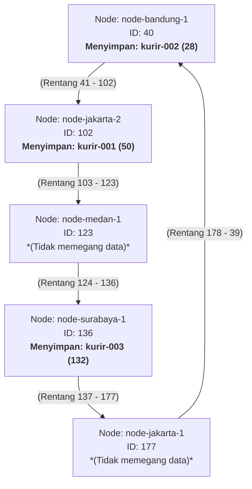

# Tugas 6 (Pekan 6) — Penamaan & Resolusi Lokasi

**Materi terkait:** Flat Naming, Structured Naming (DNS), Distributed Hash Table (DHT)/Chord.

## Studi Kasus

Pelanggan FoodGo kesulitan menemukan alamat IP server kurir yang **dinamis** (kurir berpindah lokasi/jaringan, IP-nya sering berubah). FoodGo butuh cara memetakan **ID Kurir** (identitas tetap) ke **alamat IP terkininya** tanpa server pusat tunggal yang jadi bottleneck/single point of failure.

## Tugas Kelompok

Implementasikan **simulasi Chord DHT** sederhana (single-process, tidak perlu jaringan sungguhan — cukup simulasi struktur data & algoritma di satu program Python) yang memetakan ID Kurir ke alamat IP mereka.

Konsep yang harus terlihat jalan dalam simulasi kalian:

1. **Consistent hashing**: ID Kurir dan ID Node di-hash ke ruang angka yang sama (mis. 0–255 untuk kesederhanaan, `m=8` bit).
2. **Ring topology**: node-node diurutkan melingkar berdasarkan hasil hash-nya.
3. **Lookup**: fungsi `lookup(kurir_id)` yang menemukan node mana yang bertanggung jawab menyimpan mapping ID Kurir tersebut → alamat IP-nya (aturan Chord: node dengan ID hash **terkecil yang lebih besar atau sama dengan** hash key, disebut _successor_).
4. **Perubahan topologi**: simulasikan minimal satu node baru bergabung (`join`) atau satu node keluar (`leave`), tunjukkan bagaimana mapping berpindah tanggung jawab ke node lain.

Skeleton disediakan di `src/chord_simulation.py` dengan fungsi hashing dan struktur ring sudah ada — bagian `lookup()`, `join()`, dan `leave()` sengaja dikosongkan.

### Cara Menjalankan

```bash
python3 src/chord_simulation.py
```

## Tugas Analisis (`README.md`)

1. Jelaskan **kenapa DHT/Chord** lebih cocok untuk kasus ini dibanding **flat naming sederhana** (mis. tabel pusat ID→IP) atau **DNS konvensional** — kaitkan dengan sifat "IP kurir sering berubah" dan kebutuhan tanpa titik gagal tunggal.
2. Gambarkan (boleh pakai Mermaid, lihat Tugas 2) ring topology dari simulasi kalian, tandai node mana yang bertanggung jawab atas ID Kurir mana.
3. Jelaskan apa yang terjadi pada mapping saat sebuah node **keluar** dari ring (siapa yang mengambil alih tanggung jawabnya) — dukung dengan output program.

## Jawaban

1. DHT/Chord lebih cocok untuk kasus ini dibanding **flat naming sederhana** (tabel pusat ID→IP) atau **DNS konvensional** karena sistem pelacakan kurir membutuhkan pembaruan alamat IP yang cepat. Jika menggunakan tabel pusat, sistem berisiko mengalami gangguan ketika server utamanya bermasalah dan server juga bisa melambat ketika banyak kurir memperbarui data secara bersamaan. Selain itu, DNS memiliki waktu TTL yang membuat perubahan informasi tidak selalu langsung diperbarui. Sehingga dipilih DHT/Chord karena akan membagi penyimpanan dan pencarian ke banyak node tanpa harus bergantung pada satu server pusat. Sehingga, proses pembaruan data kurir dapat berjalan lebih cepat, stabil, dan tetap berfungsi jika ada node lain yang mengalami gangguan.
2.

````markdown

````

3. Ketika sebuah node keluar dari ring, maka data (kurir) yang sebelumnya dipegang node tersebut akan dialihkan ke node terdekat lainnya (yang nilainya lebih besar dari kurir tersebut, jika tidak ada yang lebih besar, maka akan dipegang node paling kecil). Namun, pada studi kasus ini, ketika node jakarta-1 keluar, tidak ada perubahan yang terjadi dikarenakan node tersebut tidak memegang (menjadi successor) data/kurir manapun. Misalnya node jakarta-2 dihapus, maka kurir-001 yang dipegang oleh node tersebut akan dialihkan ke node yang hashnya lebih besar dari has kurir-001 (50) yaitu node medan-1 (hash: 123).
   

## Struktur Submission

```

tugas-06-penamaan-dht/
├── README.md # Analisis + diagram ring
├── JURNAL.md
├── src/
│ └── chord_simulation.py
└── bukti/ # Output program (screenshot/log) untuk skenario join & leave

```

## Rubrik Penilaian (Tugas 6)

| Komponen                               | Bobot | Kriteria                                                        |
| -------------------------------------- | ----- | --------------------------------------------------------------- |
| Implementasi lookup/join/leave benar   | 35%   | Consistent hashing & successor lookup sesuai aturan Chord       |
| Bukti perubahan topologi (join/leave)  | 25%   | Output menunjukkan mapping berpindah dengan benar               |
| Analisis kenapa DHT vs flat naming/DNS | 25%   | Argumen spesifik ke kasus IP kurir dinamis, bukan definisi umum |
| Proses & kontribusi kelompok           | 15%   | `JURNAL.md`, commit history                                     |

## Batasan Penggunaan AI (Level 2)

Kebijakan **Level 2 (AI Assisted Idea Generation & Structuring)** berlaku — lihat [`../RUBRIK-UMUM.md`](../RUBRIK-UMUM.md). Boleh bertanya konsep umum consistent hashing/Chord ke AI; **tidak boleh** meminta AI menuliskan isi `# TODO` di `src/chord_simulation.py` (`find_successor`, `join`, `leave`, dst). Catat pemakaian AI di "Log Penggunaan AI" pada `JURNAL.md`.

- `README.md` wajib menelusuri manual (langkah demi langkah) bagaimana `lookup()` menemukan successor untuk salah satu ID Kurir contoh yang dipakai di `chord_simulation.py` — bukan cuma menempelkan output program.

```

```
